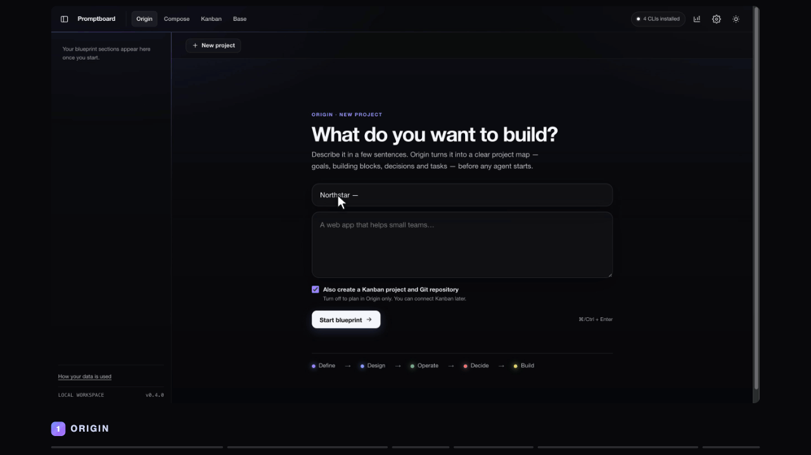
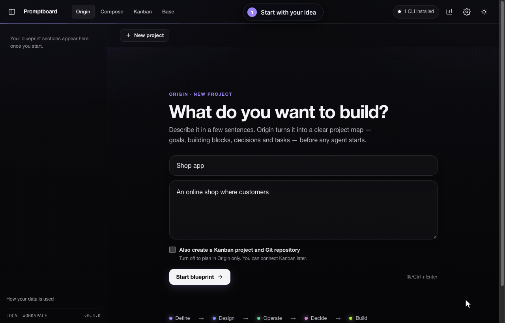
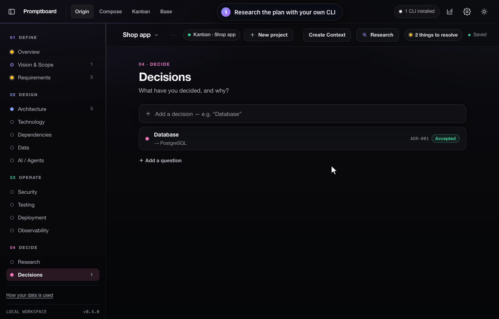
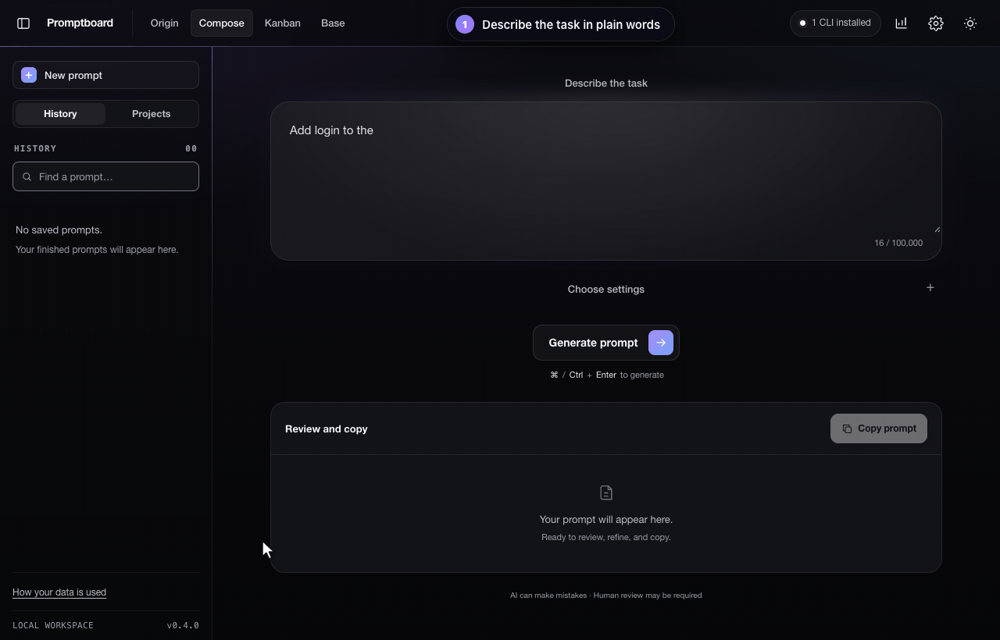
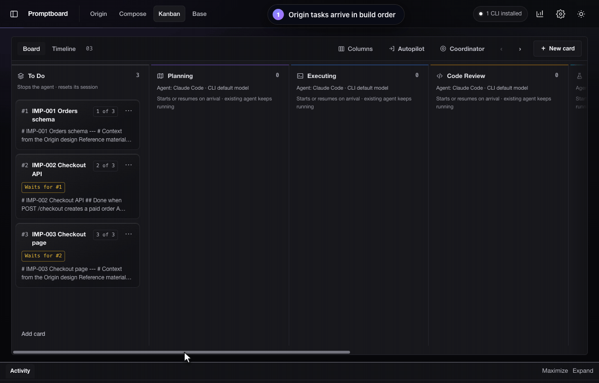
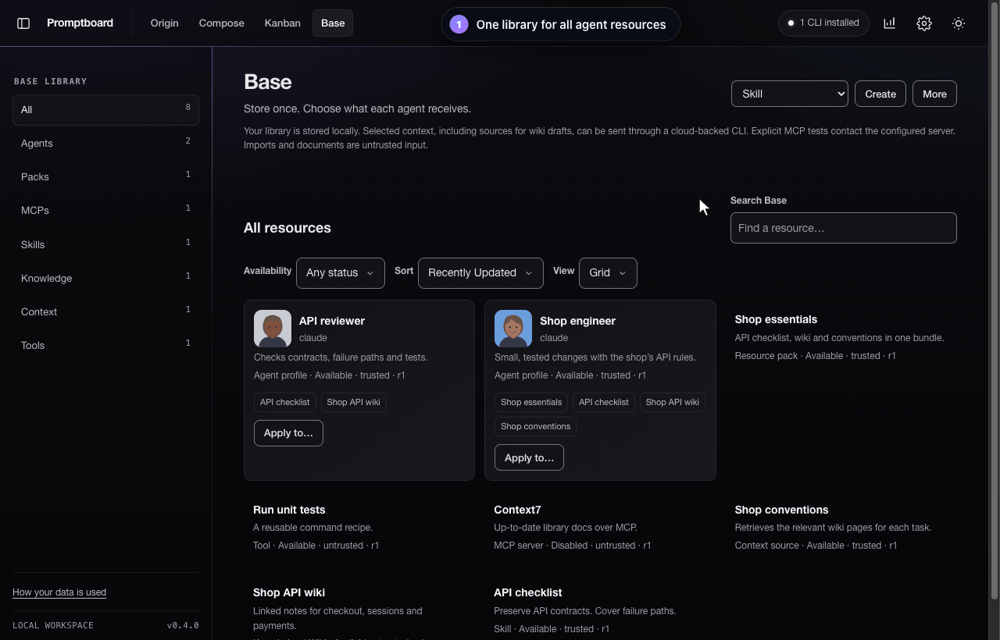

<h1 align="center">Promptboard</h1>
<p align="center">
  
</p>

<p align="center">
  <b>Plan a project, turn it into tasks, and let your coding agents ship them: planned, reviewed, tested and merged, one task at a time.</b><br>
  A local workspace for Claude Code, Codex and Gemini CLI.
</p>

<p align="center">
  <a href="#demo">Demo</a> ·
  <a href="#install">Install</a> ·
  <a href="#origin">Origin</a> ·
  <a href="#compose">Compose</a> ·
  <a href="#kanban">Kanban</a> ·
  <a href="#base">Base</a> ·
  <a href="#docs">Docs</a>
</p>

## Demo

<p align="center">
  
</p>

## Install

You need **Node.js 22.13+**, **Git**, and at least one [supported CLI](#supported-clis), signed in.

```bash
git clone https://github.com/datasound-projects/Promptboard.git
cd Promptboard
npm ci
npm start
```

Promptboard opens at **http://127.0.0.1:4318**. To update, run `git pull --ff-only && npm ci`, then `npm start`.

## How it fits together

| Page | What it does |
| --- | --- |
| [**Origin**](#origin) | Plan the project and break it into tasks. |
| [**Compose**](#compose) | Turn a rough request into a precise prompt. |
| [**Kanban**](#kanban) | Agents take each task through Planning → Executing → Code Review → Testing → Merge. |
| [**Base**](#base) | One library of agent profiles, skills, MCP servers and knowledge. |

All pages share one project: a plan in Origin becomes cards in Kanban, with nothing copied by hand. Each page also works on its own.

## Origin

**Design the project before any code is written.**

- **Guided blueprint.** 15 sections in five phases (Define, Design, Operate, Decide, Build). Rename anything, or add your own sections and questions.
- **Architecture canvas.** Blocks, connections and layers, each with its stack and rules.
- **One map.** The whole plan on a mind map, with next steps and open issues. No invented scores.
- **Checks.** Missing details, open decisions, conflicts and dependency cycles, each with the rule that found it.
- **Tasks with exact context.** Each task carries its own words, then only what it links to. Secrets are removed, and you see the exact text first.
- **Send to Kanban.** Creates To Do cards in build order, prerequisites first. Sending again never makes duplicates. When the design changes, only the affected cards are flagged.
- **Your own blocks.** Add Q&A, tables, checklists, flows and notes to any section, or build a page of your own from them.
- **Create Context.** Exports the design as one Markdown document with Mermaid diagrams.

Origin is local and deterministic. No model is called unless you ask.

<p align="center">
  
</p>

### Research

Ask your own Claude Code or Codex about any part of the plan.

- **Four modes.** Chat, Swarm (parallel agents, one per part), Decision Lab (compare options) and Audit (find gaps and weak assumptions).
- **Your sources.** Web search, documents and PDFs, Base knowledge, or a read-only MCP server.
- **Writes where you point it.** Choose a section (for example Design › Data) and the agent fills its fields, topics, questions and blocks, in your own names, even after you rename or add them.
- **Suggestions you approve.** An answer can propose decisions, blocks, connections and tasks. Preview, edit, apply one, or **Apply all**: new records arrive already linked. Nothing changes until you apply.

<p align="center">
  
</p>

## Compose

**Turn a rough request into a precise prompt for a coding agent.**

- **Settings.** 19 task types, your CLI and model, reasoning effort, level of detail, and English, German or Polish.
- **Exact details kept.** Code, quotes, file paths and URLs come through unchanged. Add your own **Terms to keep**.
- **Reviewed or Fast.** Reviewed mode makes a second, fresh call that checks every part of your request is covered, then repairs only confirmed problems. Fast mode makes one call.
- **Context grounding (optional).** Researches only the sources you choose: a project folder, documents, Context7 or your own read-only MCP servers.
- **Use the result.** Copy, edit, download as Markdown, save to a project with revisions, or split into Kanban cards.
- **Batch.** Send many Origin tasks to Compose at once: each is engineered in its own isolated, parallel run and checked for exact values, requirement coverage and acceptance checks. You approve each prompt, and only approved prompts go to Kanban, prerequisites first ([Compose Batch](docs/compose-batch.md)).

<p align="center">
  
</p>

## Kanban

**Agents do the work, task by task, and Promptboard checks every step.**

Each card gets its own Git branch and worktree. When a card enters a column, a fresh agent session starts there. Promptboard checks the result before the card moves on.

| Column | What happens | Moves on when |
| --- | --- | --- |
| Planning | An agent writes a plan, read-only. | The plan is approved. It is then frozen. |
| Executing | An agent follows the approved plan. | New changes are committed. |
| Code Review | A fresh agent reviews the diff, read-only. | No blocking findings remain. |
| Testing | Your test command runs (or an agent finds the tests). | The tests pass. |
| Merge | Promptboard merges the reviewed, tested commit. | The target branch has it. |

- **Autopilot.** Runs your queue in order. A card starts only after its prerequisites are merged, so each task builds on the code before it.
- **Scheduled cards.** Recurring cards land in To Do on a repeat, for example a nightly dependency update or a weekly docs or security sweep, and can run through Autopilot ([Schedules](docs/schedules.md)).
- **Every agent knows its task.** It gets the card's exact text, its place in the plan ("task 2 of 3"), and what its prerequisites did. It never gets another agent's conversation.
- **Rework.** Blocking findings and failing tests send the card back with the details. Rework stops when the same problem keeps coming back.
- **Safe merges.** Squash or fast-forward, only if the target hasn't moved. Otherwise the work is tested again. Conflicts go to a resolver agent, then review and tests again. Nothing is pushed unless you open a pull request.
- **Your rules.** Per board or column: CLI and model, ask or autonomous, read-only or workspace access, manual or automatic completion.
- **Live terminals.** Watch every agent and type into it. Pause and resume keep its session.
- **Run the result.** When every card is done, the board shows where the project is and the commands to start it, with Open in Finder and Open in Terminal. The project ⋯ menu copies its path any time and opens the project, or a task's worktree, in your code editor (**Open in IDE**: VS Code, Cursor, Zed, TRAE, Devin Desktop/Windsurf, Sublime Text, JetBrains IDEs, or any editor you add by path).
- **Project card.** After Done, the project's folder, branch, latest commit and last merged card. **Open project** browses and edits the files where merged work lands, like a code editor, and **Pop out** opens it in its own window. See [Project explorer](docs/project-explorer.md).
- **Live preview.** For web projects, **Start preview** in a card's Details runs the project's dev server in the card's worktree and gives you a link, so you can click-test the change before it merges ([Live preview](docs/live-preview.md)).
- **Coordinator.** A read-only overview of progress, running agents and blockers. Ask it questions; answers cite their sources.
- **Project memory.** After each merged card, one short run with a small model suggests lessons: commands that worked, conventions, gotchas and failed approaches. You approve each one; approved lessons go to every new agent of the project. Switch it off per project. See [Project memory](docs/project-memory.md).
- **GitHub.** Sign in with the GitHub CLI, search your personal and organization repositories, and clone one (or connect a clone you already have). Fetch and fast-forward only; Promptboard never sees a token. See [GitHub](docs/github.md).
- **Also:** custom columns with their own instructions, column actions (script, webhook, notification), a file browser, a timeline, labels and priorities, and board backups.

<p align="center">
  
</p>

## Base

**Set up what your agents use once, and reuse it everywhere.**

- **One library.** Agent profiles, packs, skills, knowledge wikis, context sources, MCP servers (stdio or HTTP) and command recipes.
- **Agents and Agent Profiles.** An agent is one definition (provider, model, instructions). An Agent Profile combines a primary agent, supporting agents with their responsibilities, and the resources they carry, equipped from the library with **Add from Base**.
- **Custom MD files.** AGENTS.md, CLAUDE.md, GEMINI.md, SOUL.md, MEMORY.md or any Markdown of your own, with a live preview, activation rules (always, per project, stage or CLI, on demand), project versions, and an optional write into the repository after a preview.
- **On or off at every level.** A switch on each resource, each assignment and each MCP tool. Switching off keeps the configuration.
- **Apply to…** a project or a column. The preview shows exactly what each run will get. Saving never starts an agent.
- **Delivered natively.** Each run receives its resources the provider's own way: MCP configuration, instructions or subagents. Run details show what each agent received.
- **No stored secrets.** Credentials are referenced by environment variable name only. MCP tools are discovered only when you click Test. Import MCP servers from Claude Desktop or a pasted configuration, and instruction files from a repository: they start switched off and untrusted.

<p align="center">
  
</p>

<sub>The demos use the real app with simulated agents. Saves, Git branches, checks and merges are real. Re-record them with `node scripts/record-demo.mjs`.</sub>

## Also included

- **CLIs** (top bar): connect, sign in and check each CLI.
- **Usage**: tokens, tool calls and cost estimates from your CLIs' local records.
- **Insights** (top bar): per project, how often cards needed rework by agent, model and template, time in each column, tokens and reported price per merged card, and the cards whose review or tests failed most. No model is asked. See [Insights](docs/insights.md).
- **Settings**: theme, start page, default agents, how many agents run at once, terminal and notifications.
- **Remote access (iPhone)**: open Promptboard in Safari on your phone through Tailscale or Twingate after pairing it once. Everything keeps running on the computer. See [Remote access](docs/remote-access.md).
- **Command line**: `node bin/ste.mjs --provider claude < request.txt` writes a prompt without the app. Run `--help` for all options.

## Supported CLIs

| CLI | Compose | Kanban |
| --- | --- | --- |
| [Claude Code](https://code.claude.com/docs/en/quickstart) | ✓ | ✓ |
| [OpenAI Codex CLI](https://developers.openai.com/codex/cli) | ✓ | ✓ |
| [Gemini CLI](https://geminicli.com/docs/get-started/installation/) | ✓ | ✓ (not live-verified) |
| [Antigravity](https://antigravity.google/docs/getting-started?tab=cli) (`agy`) | ✓ | — |

Agents run through each CLI's own sign-in and plan. Promptboard has no account of its own.

## Privacy and security

- Runs only on `127.0.0.1`. No analytics or telemetry. [Remote access](docs/remote-access.md) for your iPhone is off until you turn it on: then a paired device reaches it through Tailscale or Twingate, never the public internet.
- Prompts and the context you select go only to the provider you choose, through its CLI.
- Boards, logs and worktrees stay in your local data folder. New repositories go in `~/Promptboard/projects`.
- In autonomous mode an agent can change files in its task workspace. Read [SECURITY.md](SECURITY.md) before you use sensitive repositories.

## Good to know

- Without a test command, Testing relies on the agent's own report. Set a command for an independent check.
- Promptboard answers only the CLI's folder-trust prompt. Other prompts (sign-in, changed hooks, updates) need you in the terminal.
- Another port: `npm start -- --port 4320`. One Promptboard runs per data folder: a second start on the same folder is refused, so two apps never overwrite each other's board. Check your CLIs: `node bin/ste.mjs --doctor`.

## Docs

- [Kanban execution](docs/kanban-execution.md): stages, rework, merge and error codes · [GitHub](docs/github.md) · [Remote access](docs/remote-access.md)
- [Origin](docs/origin.md) · [Research](docs/origin-research.md) · [Project Context](docs/origin-project-context.md) · [Shared projects](docs/shared-projects.md) · [Coordinator](docs/coordinator.md) · [Project memory](docs/project-memory.md)
- [Compose context](docs/compose-context.md) · [Prompt checks](docs/verification.md)
- [Base delivery](docs/base-delivery.md) · [CLI adapters](docs/cli-adapters.md) · [Session persistence](docs/session-persistence.md)
- [Changelog](CHANGELOG.md) · [Release verification](RELEASE-VERIFICATION.md) · [All docs](docs/)

## Contributing

Plain Node.js with ES modules: no framework, no build step. Before a pull request, run `npm run check` and `npm test`. See [CONTRIBUTING.md](CONTRIBUTING.md).

## License

[MIT](LICENSE) · [Third-party notices](THIRD_PARTY_NOTICES.md)

<sub>Prompt writing rules draw on ASD-STE100 Simplified Technical English. ASD and STEMG do not endorse this project.</sub>
